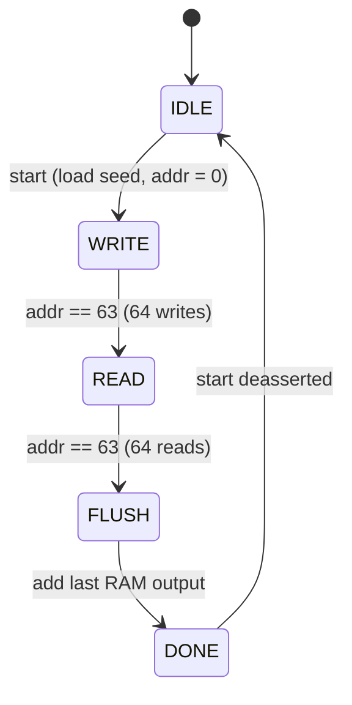
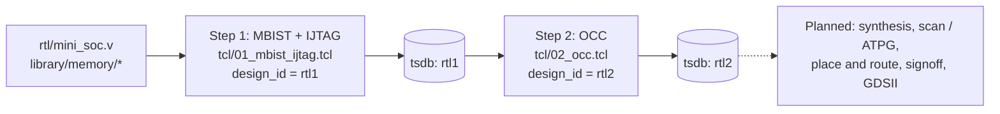
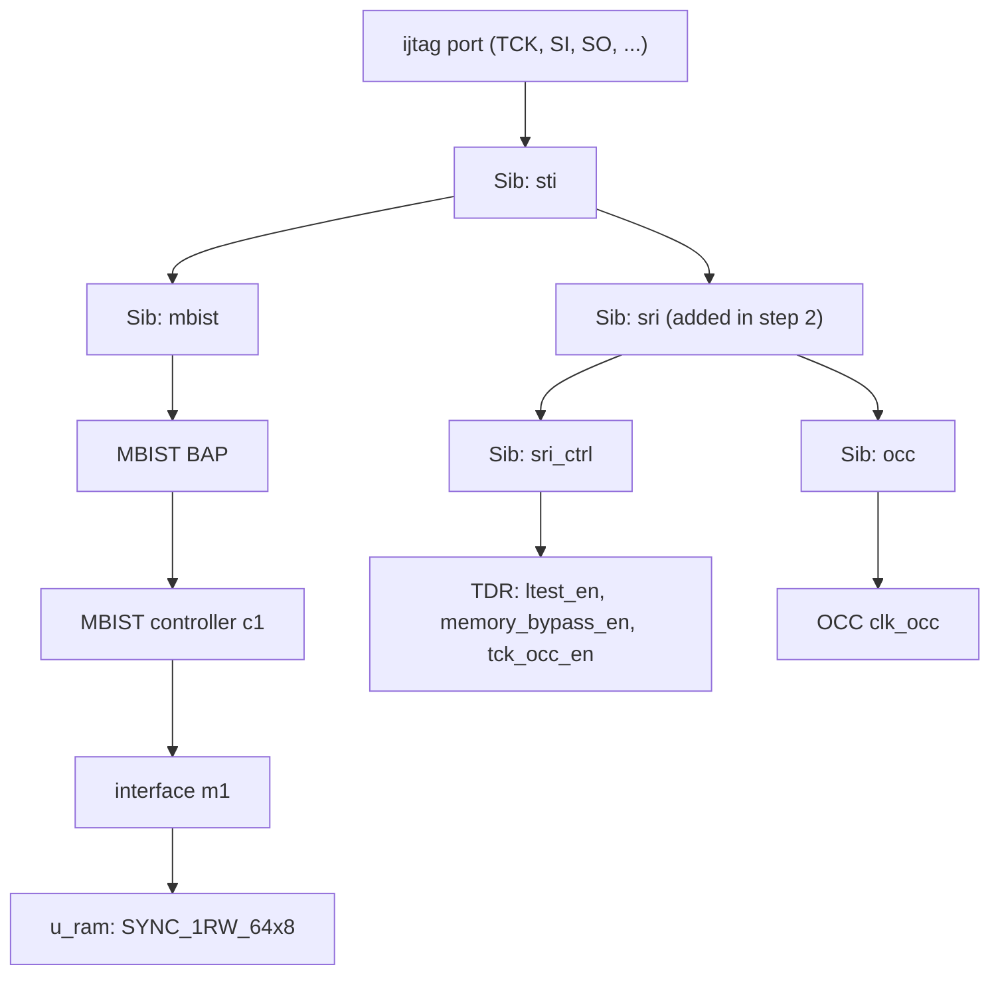
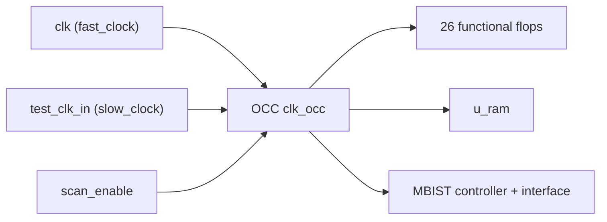

# dft_mini

**A deliberately tiny SoC used to learn the Design-for-Test (DFT) flow end to end
with Tessent Shell 2022.4: Memory BIST, IJTAG and an On-Chip Clock controller (OCC).**

The design is small enough that every generated file can be read and understood.
That is the point: this repository is a *learning project*, built one step at a
time, and it is intended to be extended all the way from RTL to **GDSII**
(see the [roadmap](#roadmap-towards-gdsii)).

---

## Contents

1. [Goals](#goals)
2. [The design](#the-design)
3. [DFT concepts used here](#dft-concepts-used-here)
4. [The flow](#the-flow)
5. [What the DFT steps add](#what-the-dft-steps-add)
6. [Repository layout](#repository-layout)
7. [Getting started](#getting-started)
8. [Reports, step by step](#reports-step-by-step)
9. [What Tessent generates](#what-tessent-generates)
10. [Using a real RAM macro](#using-a-real-ram-macro)
11. [Status and known limitations](#status-and-known-limitations)
12. [Roadmap towards GDSII](#roadmap-towards-gdsii)
13. [Legal notes](#legal-notes)

---

## Goals

- Understand what each DFT insertion step does to the RTL, the netlist
  connectivity (ICL) and the test patterns, by inspecting small, readable output.
- Keep each step **separate and re-runnable**: one Tcl script per step, one report
  per sub-step, and a script (`show_changes.sh`) that diffs the RTL before/after.
- Build a base that can later be pushed through synthesis, scan/ATPG, place &
  route and signoff to produce a GDSII.

## The design

`mini_soc` is 26 flops (FSM, 6-bit address counter, 8-bit LFSR, 8-bit checksum)
plus one 64x8 single-port synchronous RAM, `SYNC_1RW_64x8`. It has a single clock
(`clk`), a synchronous active-low reset and no asynchronous set/reset.

On `start` it writes 64 LFSR values into the RAM, reads them all back, and
accumulates their sum as a checksum.



| Port | Dir | Description |
|---|---|---|
| `clk` | in | functional clock (the OCC intercepts this in step 2) |
| `rst_n` | in | synchronous reset, active low |
| `start` | in | begin the write / read / checksum sequence |
| `seed[7:0]` | in | LFSR seed (a seed of `0` is mapped to `1`) |
| `busy` | out | high while in WRITE / READ / FLUSH |
| `done` | out | high in DONE |
| `checksum[7:0]` | out | 8-bit sum of the 64 values read back |

The LFSR polynomial taps are bits 7, 5, 4, 3. Reads are pipelined by one cycle
(`rd_vld`), which is why a FLUSH state is needed to add the final RAM output.

## DFT concepts used here

| Term | Meaning in this project |
|---|---|
| **MBIST** (Memory BIST) | Hardware added next to the RAM that tests it at speed on-chip: a controller, a per-memory interface ("collar") and a BIST access port. Here it runs the **SMarchCHKBci** march algorithm. |
| **IJTAG** (IEEE 1687) | A scalable network for reaching on-chip test instruments over the JTAG port. Built from SIBs and TDRs. |
| **SIB** (Segment Insertion Bit) | A 1-bit switch in the IJTAG scan path that opens/closes access to a sub-network (e.g. "mbist", "occ"). |
| **TDR** (Test Data Register) | A register on the IJTAG network, used here to hold DFT control signals (`ltest_en`, `memory_bypass_en`, `tck_occ_en`). |
| **ICL / PDL** | *Instrument Connectivity Language* describes how instruments are wired; *Procedural Description Language* describes how to operate them. Tessent extracts the ICL and writes PDL for each instrument. |
| **OCC** (On-Chip Clock controller) | Sits on the clock path so a test can shift with a slow clock and capture with the fast functional clock, controlled through IJTAG. |
| **TSDB** | Tessent Shell Database: the `./tsdb` directory where all generated designs, instruments and patterns are stored, keyed by `design_id`. |
| **DftSpecification** | The declarative description (generated, then optionally edited) of what to insert. `process_dft_specification` carries it out. |

## The flow



Each step is the same shape: **load** (a) -> **requirements + DRC** (b) ->
**create/validate the DftSpecification** (c) -> **insert + extract ICL** (d) ->
**generate patterns** (e). Each sub-step writes its own `reports/<step><letter>_*.rpt`.

Step 2 starts from step 1's result (`read_design mini_soc -design_id rtl1`), so the
OCC is added to the *same* IJTAG network, which makes the before/after comparison
direct.

## What the DFT steps add

### Step 1 (`rtl1`): MBIST + IJTAG

- The RAM is recognised as memory instance `u_ram` via its `.tcd_memory` description.
- One MBIST controller **`c1`** with one memory interface **`m1`** (on `u_ram`), plus a BIST access port (BAP).
- An IJTAG network: `Sib(sti)` -> `Sib(mbist)`.
- New top-level ports: `ijtag_tck`, `ijtag_reset`, `ijtag_ce`, `ijtag_se`, `ijtag_ue`, `ijtag_sel`, `ijtag_si`, `ijtag_so`.
- ICL instances: 6.

Figures reported by Tessent for the MBIST controller:

| Item | Value |
|---|---|
| Algorithm | `SMARCHCHKBCI` (from the Tessent pattern library) |
| Controller type | programmable |
| BIST clock period | 10 ns |
| Test length | 2330 cycles (23.3 us) |
| Estimated power | 0.58 mW |
| Controller flop count | 114 |
| Failure limit | 4096 |
| Parallel static retention test | on |

### Step 2 (`rtl2`): OCC

- DFT signals added: `ltest_en`, `memory_bypass_en`, `tck_occ_en` (IJTAG registers) and `scan_en`, `shift_capture_clock` (new ports `scan_enable`, `test_clk_in`).
- One OCC **`clk_occ`** intercepts `clk`: `fast_clock = clk`, `slow_clock = test_clk_in`, `scan_en = scan_enable`.
- After insertion, **everything clocked runs from the OCC output**: the 26 functional flops, the RAM, and the MBIST controller/interface all use the OCC's `clock_out`.
- IJTAG network extended with `Sib(sri)` -> { `Sib(sri_ctrl)` -> TDR, `Sib(occ)` }.
- ICL instances: 11.





### Patterns generated

For each step the patterns spec (`signoff`) produces three pattern sets, written
as Verilog testbench-style patterns plus PDL:

| Pattern | Purpose |
|---|---|
| `ICLNetwork` | verifies the IJTAG network (ICL) is reachable and correct |
| `MemoryBist_P1` | go/no-go MBIST run (`run_time_prog`, reduced address count) |
| `MemoryBist_ParallelRetentionTest_P1` | parallel static retention test of the RAM |

## Repository layout

```
rtl/mini_soc.v                      design under DFT
tb/tb_mini_soc.v                    self-checking functional testbench (iverilog)
library/memory/SYNC_1RW_64x8.v      behavioral RAM model (stand-in for a macro)
library/memory/SYNC_1RW_64x8.tcd_memory   Tessent memory description of the RAM
tcl/01_mbist_ijtag.tcl              step 1: MBIST + IJTAG   (design_id rtl1)
tcl/02_occ.tcl                      step 2: OCC             (design_id rtl2)
reports/*.rpt                       reference transcripts from a full run
show_changes.sh                     diff original RTL vs Tessent-modified RTL
cshrc_tessent.example               environment template (license, install path)
Makefile                            `make sim`: functional simulation
.github/workflows/sim.yml           CI: runs `make sim`
```

Not committed (git-ignored): `tsdb/` (Tessent output, see [Legal notes](#legal-notes)),
`reports/for_synthesis.tcl` (regenerated; contains absolute paths) and
`cshrc_tessent` (your site-specific environment).

## Getting started

### 1. Functional check (no Tessent needed)

```bash
make sim        # requires iverilog; prints "PASS: checksum=8d"
```

The testbench starts the design with seed `0xA5`, waits for `done`, and compares
`checksum` with the sum of the RAM contents.

### 2. Set up the Tessent environment

```bash
cp cshrc_tessent.example cshrc_tessent
# edit: license server, install path
source cshrc_tessent          # csh/tcsh
```

### 3. Run the DFT steps (one at a time, from the repo root)

```bash
tessent -shell -dofile tcl/01_mbist_ijtag.tcl     # MBIST + IJTAG  (rtl1)
./show_changes.sh                                  # inspect what step 1 added
tessent -shell -dofile tcl/02_occ.tcl              # OCC           (rtl2)
./show_changes.sh
```

Run them in order: step 2 reads step 1's result from `./tsdb`.

Optional environment variables (csh: `setenv`, bash: `export`):

| Variable | Effect |
|---|---|
| `TCELLLIB=<file>` | read a cell library before loading the design |
| `RUN_SIM=1` | run the Questa testbench simulations of the generated patterns at the end of each step |

### 4. Inspect the result

`./show_changes.sh` lists every Verilog file Tessent generated and prints a
unified diff of `rtl/mini_soc.v` against the modified RTL for each `design_id`.
The modified top-level is at
`tsdb/dft_inserted_designs/mini_soc_<id>.dft_inserted_design/modified_rtl_files/mini_soc.v`.

## Reports, step by step

Read them in order. The same shape is used for both steps.

| Report | Key commands | What to look at |
|---|---|---|
| `01a_load` | `set_context dft -rtl`, `set_design_sources`, `read_verilog`, `report_memory_instances` | RAM found as memory instance `u_ram`, TCD loaded |
| `01b_requirements_drc` | `set_dft_specification_requirements -memory_test on`, `add_clocks`, `check_design_rules` | clock `clk` (10 ns), DRC result, control points |
| `01c_dft_spec` | `create_dft_specification`, `process_dft_specification -validate_only` | auto-generated spec: MemoryBist controller, IjtagNetwork |
| `01d_insert` | `process_dft_specification`, `extract_icl` | files written, IJTAG instances, ICL modules |
| `01e_patterns` | `create_patterns_specification`, `process_patterns_specification` | pattern sets generated; simulation (if `RUN_SIM=1`) |
| `02a_load` | `read_design mini_soc -design_id rtl1` | step 1 result reloaded |
| `02b_dft_signals_drc` | `add_dft_signals`, `set_dft_specification_requirements -logic_test on` | the five DFT signals and the inferred control points |
| `02c_dft_spec` | `create_dft_specification -sri_sib_list occ`, `add_config_element OCC/Controller(clk_occ)` | OCC added to the spec under `Sib(occ)` |
| `02d_insert` | `process_dft_specification`, `extract_icl`, `write_design_import_script` | new ICL (11 instances), Genus import script |
| `02e_patterns` | same as `01e` | pattern sets for the OCC-extended design |

Warnings that appear in the included run (none are errors): an MBIST generation
warning about data-register width, rule `FN1` / `FP13` counts during ICL
extraction, and DRC rule `D7` ("edge-triggered clock ports set to stable high").

## What Tessent generates

Everything below lands in `tsdb/` (not committed).

| Location | Contents |
|---|---|
| `dft_inserted_designs/<design>.dft_inserted_design/` | `modified_rtl_files/mini_soc.v` (RTL with DFT), `.icl`, `.pdl`, `.sdc`, ICL graybox, dictionaries |
| `dft_inserted_designs/<design>.dft_spec` | the DftSpecification that was applied |
| `instruments/*_cells.instrument` | generic RTL cells (and2, mux2, clock gate, ...) |
| `instruments/*_ijtag.instrument` | SIB / TDR RTL and ICL |
| `instruments/*_mbist.instrument` | MBIST controller, interface, BAP: RTL, ICL, PDL, TCD, SDC, generation log |
| `instruments/*_occ.instrument` | OCC RTL, ICL, PDL, TCD |
| `patterns/*.patterns_signoff/` | `ICLNetwork`, `MemoryBist_P1`, `MemoryBist_ParallelRetentionTest_P1` (`.v`, `.vec`, `.pdl`) |

The `*.synthesis_dictionary` / `design_source_dictionary` files record how to
read these into synthesis, which is what `write_design_import_script` turns into
`reports/for_synthesis.tcl`.

## Using a real RAM macro

The RAM here is a behavioral stand-in. To use a real macro (e.g. from a GPDK):

1. Replace `library/memory/SYNC_1RW_64x8.v` with the macro's Verilog model.
2. Edit `SYNC_1RW_64x8.tcd_memory`: `Core` name = module name; `Port` names and
   functions = the real pins; `NumberOfWords`, `NumberOfBits`, `LogicalPorts`
   and the `AddressCounter` split (currently column = `A[1:0]`, row = `A[5:2]`)
   must match.
3. Update the RAM instance in `rtl/mini_soc.v` and the file name in both Tcl files.

Later stages (place & route, signoff) will also need the macro's physical views
(timing library, LEF, GDS), not just its Verilog model.

## Status and known limitations

- Both Tcl steps ran to completion in Tessent Shell 2022.4 (see `reports/`).
- The Questa pattern simulations (`RUN_SIM=1`) were **not** run, so the generated
  patterns are not simulation-verified here.
- CI runs only the functional testbench on the **original** RTL. The
  DFT-modified netlists are not simulated.
- **No scan chains are inserted yet.** `scan_en` / `shift_capture_clock` and the
  OCC prepare for logic test, but the 26 functional flops are not stitched into
  scan chains. That belongs to a later step.
- The functional testbench uses a single seed, reads the RAM through a
  hierarchical reference (`dut.u_ram.mem`) and has no timeout, so a design hang
  would hang the simulation.
- The scripts were written from the Tessent 2022.4 manuals; if a future tool
  version complains, the `add_dft_signals` lines in `02_occ.tcl` and the TCD
  properties are the most version-sensitive parts.

## Roadmap towards GDSII

Checked items are done in this repo; the rest are planned. Tool names are
examples, not commitments.

- [x] RTL design and functional testbench
- [x] RAM memory description (TCD) and DFT requirements
- [x] MBIST + IJTAG insertion (step 1) with ICL/PDL and patterns
- [x] OCC insertion (step 2) and synthesis import script
- [ ] Simulate the generated patterns (`RUN_SIM=1`) and review pass/fail
- [ ] Logic synthesis of the DFT-inserted RTL (the import script is already written for Genus)
- [ ] Scan chain insertion and ATPG (stuck-at / at-speed) using the OCC
- [ ] Gate-level simulation with the DFT netlist
- [ ] Constraints: functional + test-mode SDC (Tessent already writes `.sdc` for the instruments)
- [ ] Floorplan, placement, clock tree synthesis, routing (real RAM macro with LEF/lib/GDS)
- [ ] Post-layout STA, physical verification (DRC / LVS)
- [ ] **GDSII stream-out**

Suggested layout as the project grows: `syn/`, `scan_atpg/`, `pnr/`, `signoff/`,
each with its own scripts and `reports/`, following the same one-script-per-step,
one-report-per-sub-step convention used here.

## Legal notes

- Tessent is a product of Siemens; this project is an independent learning
  exercise and is not affiliated with or endorsed by Siemens.
- The repository contains only the hand-written sources, scripts and tool
  *transcripts*. `tsdb/` is deliberately excluded: Tessent-generated files carry
  a Siemens proprietary/confidential header, and their use is governed by your
  license agreement. Regenerate them locally with the two Tcl steps.
- No license has been chosen for this repository yet; add a `LICENSE` file before
  inviting reuse.
